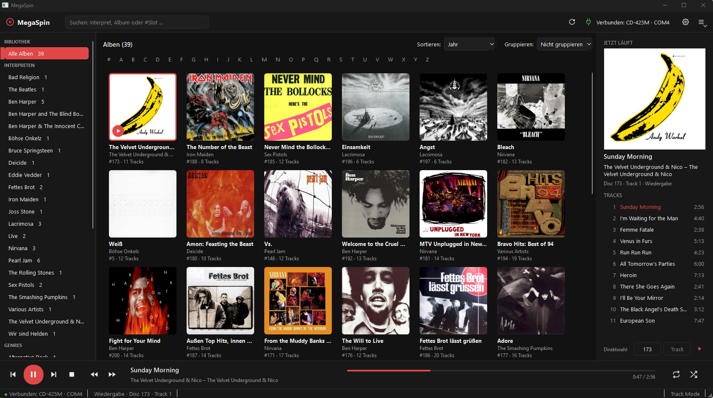
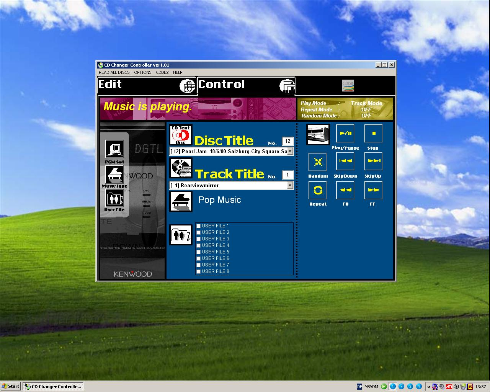
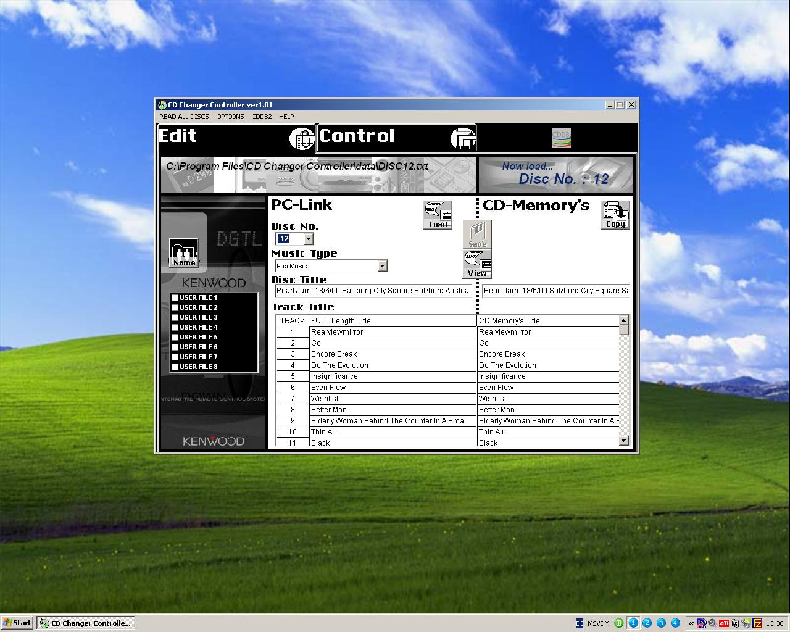
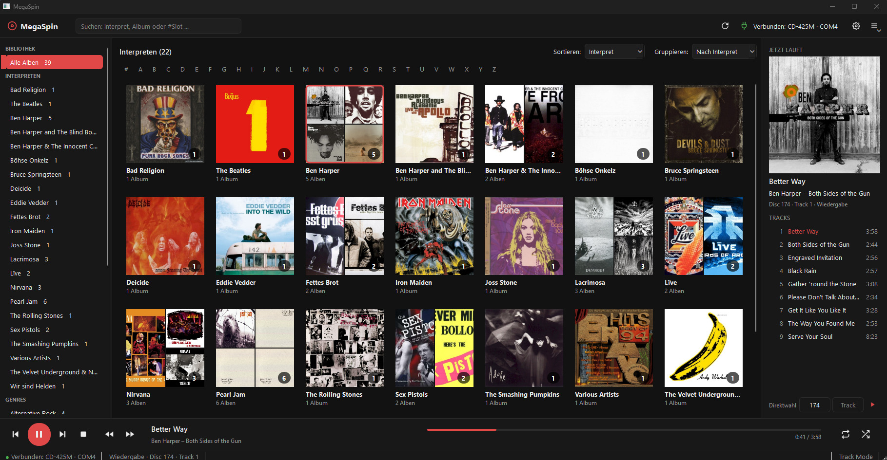
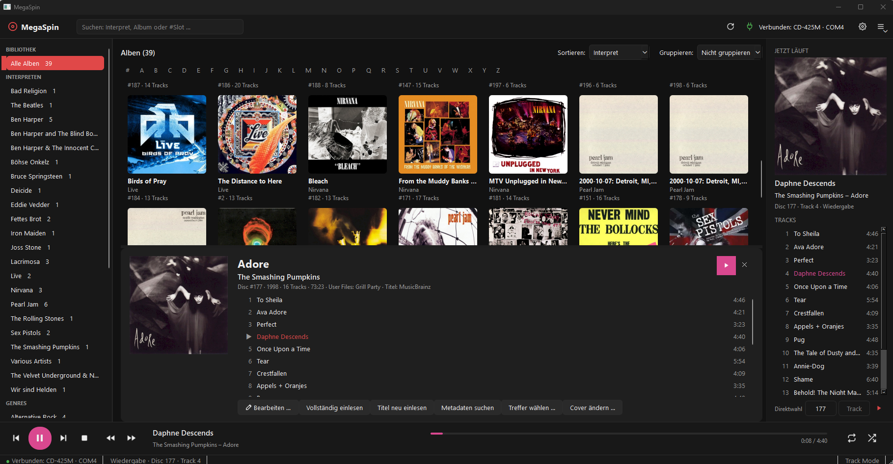
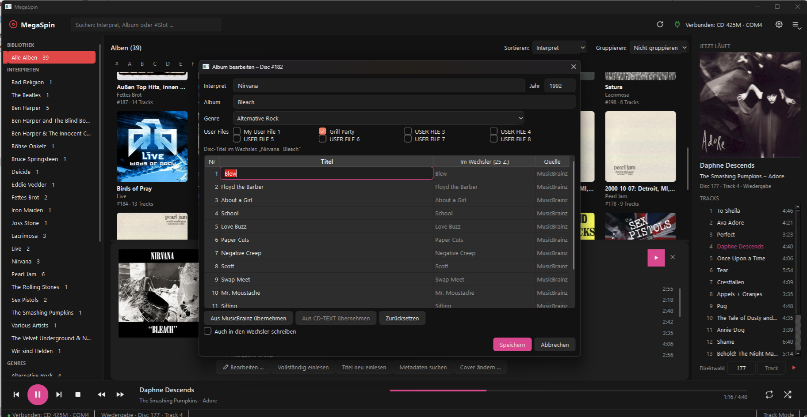
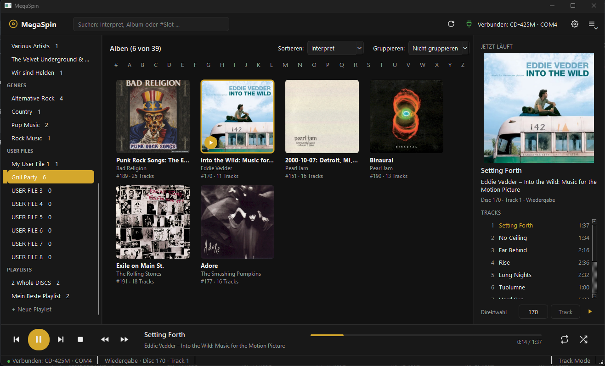

# MegaSpin

**A modern desktop app for 200-disc Kenwood mega CD changers with a PC link.**
MegaSpin replaces the old **Kenwood "CD Changer Controller" (NetNamer)** PC-LINK software from the late 1990s and early 2000s. It runs on current Windows and Linux systems.

> ⚠️ **Beta.** MegaSpin is usable every day, but it is not a stable release yet. Expect rough edges, and please report problems. Your changer's memory is only written when you explicitly ask for it.

> 🔍 **Author's note:** These Kenwood mega CD changers use a **proprietary serial protocol that is not public**. It was reverse-engineered from the original software for interoperability, with the decompiler [Ghidra](https://github.com/NationalSecurityAgency/ghidra), the disassembler [Capstone](https://www.capstone-engine.org/) and AI assistance. The serial monitor [Device Monitoring Studio](https://www.hhdsoftware.com/device-monitoring-studio) was used to monitor, log and analyze the raw serial data and the half-duplex communication between PC and changer. Before it ran on real hardware, MegaSpin was first developed against a **simulator, a digital twin of the changer** built from these captures. Every feature was then verified live on the changer. MegaSpin contains no code, binaries or assets from the original software.

> 🇩🇪 **German only for now.** Unfortunately, the user interface is currently available in German only. An English translation will follow in due course.

<a href="screenshots/megaspin-library.png"></a>

<sub>Click any screenshot to open it in full size.</sub>

---

## Why MegaSpin?

The original PC-LINK software no longer fits modern systems:
- It was written for Windows 95–XP with Visual Basic 6.0.
- It relies on CDDB, an online disc database that shut down years ago.
- Its cramped 800 × 600 window shows one disc at a time.
- On long CD-TEXT discs it gives up halfway: it waits only 200 ms between data packets, and the changer sometimes pauses longer which leads to timeouts and other annoying bugs

MegaSpin talks to the changer over the same serial link (PC-LINK). It turns your 200 discs into a browsable cover library, much like a music player.

**Then: the original "CD Changer Controller" (NetNamer) on Windows XP**

<p>
<a href="screenshots/original-software-control.jpg"></a>
<a href="screenshots/original-software-edit.jpg"></a>
</p>

**Now: MegaSpin**

<p>
<a href="screenshots/megaspin-grouped-by-artist.png"></a>
<a href="screenshots/megaspin-album-details.png"></a>
</p>
<p>
<a href="screenshots/megaspin-edit-album.png"></a>
<a href="screenshots/megaspin-user_files.png"></a>
</p>

<sub>Library grouped by artist (cover collage with album count) · album details with track list ·
editing titles, genre and user files, with a preview of what the changer will store ·
all albums of a user file ("Grill Party"), ready to play in order or shuffled.</sub>

---

## Supported changers

| Model | Region | Status |
|---|---|---|
| **DPF-J6030** | Europe / other markets | ✅ tested |
| **CD-425M** | USA / Canada (same unit as DPF-J6030) | ✅ tested |
| CD-4260M, CD-4700M | from the same product family (same manual, same PC-LINK) | ❓ probably works, untested. Feedback welcome! |

The changer reports itself as `CD-425M` over the serial link.

---

## Features

**Library and covers**
- Cover grid of all discs. Sort by artist, album, year, slot or last played. Group by **artist** (cover collage with album count) or by **year**.
- Sidebar with artists, genres (music types), the 8 user files and your playlists. Live search by artist, album or slot number (`#150`).
- **Automatic titles and covers from [MusicBrainz](https://musicbrainz.org) and the [Cover Art Archive](https://coverartarchive.org)**. The disc's table of contents (TOC) identifies the album. Multi-disc sets are recognized. If several releases match, you pick the right one. You can also set your own cover image.

**Reading from the changer**
- **Quick scan:** finds the occupied slots and reads the titles stored in the changer, the genre and the user files. It needs no disc mechanics, about 1 s per disc.
- **Full read:** loads each disc to read its **TOC** (track count and track lengths) and **CD-TEXT**.
- "Read all discs" lets you refresh everything at once, as in the original software, optionally from scratch.
- **Detects discs added or removed** through the door. The new discs are read automatically. A disc swapped in the same slot is recognized the next time it is loaded.

**Writing to the changer**
- Edit artist, album, year, track titles, genre and user files of any disc (`F2`).
- Optionally **write the titles, genre and user files into the changer's memory (EEPROM)**. The changer can then show them on its own display and use them for its genre and user-file play modes. A preview shows exactly what the changer will store: 25 characters per title, umlauts transliterated, up to 20 tracks.
- Rename the 8 user files and write the names to the changer.
- Import the data of the old program (`…\CD Changer Controller\data\`).

**Playback**
- Player bar with play/pause, stop, previous/next, hold-to-fast-forward/rewind, repeat and random. The changer's state is shown live, also when you use the remote control.
- Double-click an album or track to play it. Direct selection of disc and track number.
- **Playlists** of whole discs and single tracks. **Play a genre, a user file or an artist** (in order or shuffled). MegaSpin starts each next entry automatically.

**Tools**
- Settings for the port, auto-connect, MusicBrainz on/off and the accent color.
- Protocol console (`F12`): every byte between PC and changer, with a plain-text explanation.

---

## What you need

1. **The changer** with its 9-pin RS-232C PC-LINK port on the back.
2. **A PC** with Windows 10/11 or Linux, and **Python 3.11 or newer** (an installer is planned).
3. **The right cable.** The changer needs a **crossed (null-modem) serial cable**, called an *"RS-232C connection cable (Reverse type)"* in the changer's manual. A normal "straight" serial cable does **not** work.

| Your PC has … | Use |
|---|---|
| a 9-pin serial port (COM port) | **Null-modem cable, D-Sub 9 (DE-9) female ↔ female**, RX/TX crossed |
| only USB | **USB-to-RS-232 null-modem cable with a female DE-9 end**, e.g. [StarTech **ICUSB232FTN**](https://www.startech.com/en-us/cards-adapters/icusb232ftn) (FTDI chip, null-modem built in). It plugs straight into the changer. |
| a USB-serial adapter already (usually a male DE-9 end) | the adapter **plus** a null-modem cable DE-9 female ↔ female |

Only three wires are used (RX, TX, GND). Hardware handshake is not needed. MegaSpin sets the port to 9600 baud, 8 data bits, no parity and 2 stop bits automatically.

---

## Installation

MegaSpin is not packaged yet. Install it with Python:

```bash
git clone https://github.com/pasce/megaspin.git
cd megaspin
pip install .
```

**Windows:** Get Python from [python.org](https://www.python.org/downloads/) and tick "Add python.exe to PATH" during setup.

**Linux:** Your user needs access to the serial port, e.g. `sudo usermod -aG dialout $USER`, then log out and back in. Ports are called `/dev/ttyUSB0` (USB) or `/dev/ttyS0`. Linux support is less tested than Windows.

---

## Getting started

1. Connect the changer to the PC and switch it on.
2. Start MegaSpin:
   ```bash
   megaspin                     # or: python -m megaspin
   megaspin --port COM4         # connect to a specific port right away (Linux: --port /dev/ttyUSB0)
   megaspin --sim               # try it without a changer (built-in simulator)
   ```
3. On the first start, the connection dialog searches all serial ports for the changer. Pick it and confirm. MegaSpin remembers the port and connects automatically next time.
4. A **quick scan** runs automatically and fills the library with all occupied slots.
5. For track lengths, CD-TEXT, titles and covers, click **⟳ → "Full" → "All discs" / "Only incomplete"**. Each disc is loaded briefly, about 15 s per disc. Titles and covers are then fetched in the background.
6. Optional: **☰ → "Import data from the old program"** takes over your titles and user-file names from the old software.

Your library is stored locally and is available immediately on the next start, even without the changer connected:
- Windows: `%LOCALAPPDATA%\megaspin`
- Linux: `~/.local/share/megaspin`

---

## Using MegaSpin

| Action | How |
|---|---|
| Show album details and tracks | click a cover |
| Play an album / a track | double-click the cover / the track, or `Enter` |
| Edit titles, genre, user files (optionally write to the changer) | right-click → *Edit…* or `F2` |
| Add to a playlist | right-click a cover or a track → *Add to playlist* |
| Play a genre, user file, artist or playlist | right-click it in the sidebar → *Play all* / *Shuffle* |
| Group the library | *Group:* none / by artist / by year (next to *Sort*) |
| Read discs again | ⟳ in the header, or right-click → *Full read* (`F5`) |
| Wrong album or no cover? | album details → *Choose match…* / *Change cover…* |
| Settings / protocol console | ⚙ or `Ctrl+,` / `F12` |

**Keyboard shortcuts:**

| Keys | Action |
|---|---|
| `Space` | play / pause |
| `Ctrl+→` / `Ctrl+←` | next / previous track (next/previous entry while a playlist runs) |
| `Ctrl+Shift+→` / `Ctrl+Shift+←` (hold) | fast forward / rewind |
| `Ctrl+.` | stop |
| `Ctrl+R` / `Ctrl+S` | repeat / random |
| `Ctrl+F` | search |
| `Ctrl+L` | go to the album that is playing |
| `Esc` | close details, leave a group, clear the search |

### Good to know

- **The playing time is an estimate.** The changer never reports the play position. MegaSpin counts the time from start, pause and the measured fast-forward/rewind speed (about 16×). After spooling, the time is marked with "≈".
- **CD-TEXT discs:** the changer replaces your own titles with the disc's CD-TEXT each time the disc is loaded. Genre and user files are kept. MegaSpin warns you about this when you write titles.
- **The changer stores at most 25 characters per title and titles for up to 20 tracks.** MegaSpin keeps the full titles in its own library.
- **Playlists, genre and user-file play are controlled by MegaSpin**, not by the changer. If you choose something else on the changer or the remote, the playlist stops.
- Only titles and covers are fetched from the internet. You need no account. Nothing is uploaded except the anonymous disc lookup.

---

## Known limitations (beta)

- **The user interface is German only for now.** English is planned.
- No installer yet (Windows setup / Linux AppImage are planned).
- The changer's own program list (PGM) and its built-in genre/user-file play modes are not used. MegaSpin replaces them with playlists.

---

## Under the hood

- Python 3.11+, PySide6 (Qt 6), pyserial, SQLite.
- The serial protocol of the changer was reverse-engineered from the original software and verified live on the changer.
- Command-line tool for quick checks: `megaspin-cli --port COM4 status | slots | disc 150 | play 150 3 | monitor 60`
- `megaspin --sim` starts the app with a built-in changer simulator. You can try it without any hardware.

---

## License

MIT – see [LICENSE](LICENSE).

---

## Disclaimer

MegaSpin is an independent hobby project. It is not affiliated with, endorsed by or supported by JVCKENWOOD Corporation. "Kenwood" and the model names are trademarks of their respective owners and are used here only to describe compatibility. Use at your own risk.
